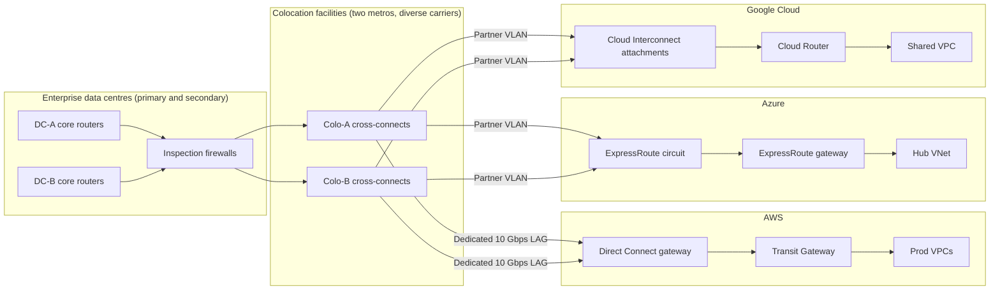
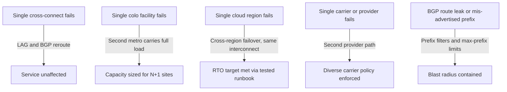

# Multicloud Private Interconnect Design

Hands-on reference architecture and working infrastructure-as-code for private, dedicated connectivity between an enterprise data centre and AWS (Direct Connect), Azure (ExpressRoute) and Google Cloud (Cloud Interconnect), built for regulated, mission-critical estates: banks, Fortune 100 and Fortune 500 enterprises, federal agencies and parastatals.

> Repo About text: Working multicloud private interconnect blueprint (AWS Direct Connect, Azure ExpressRoute, GCP Cloud Interconnect) with Terraform, diagrams, resiliency maths and an executive decision model for regulated enterprises.

## Why this matters to the C-suite

Public-internet VPNs are cheap but unpredictable. Regulated workloads, core banking replication, payments, national identity and citizen-service platforms need predictable latency, contractual SLAs, private routing and an auditable path. Getting this wrong is not a networking problem; it is a resilience, regulatory and board-level risk. This repo answers four executive questions:

1. **What does it cost** per month and per year at our traffic profile, including egress?
2. **How resilient is it**, and what does a single carrier or facility failure actually do to revenue-bearing services?
3. **Who owns what** in a failure, and which regulator-facing evidence do we produce?
4. **What is the path from here to there**, in phases we can fund and govern?

## Reference architecture



## Failure domains and what we design for



## Repository layout

| Path | Purpose | Audience |
|---|---|---|
| `docs/executive-brief.md` | One-page decision memo for the board and CIO | C-level |
| `docs/architecture.md` | Full design, traffic flows, routing policy, diagrams | Architects, CISO |
| `docs/decisions.md` | Architecture decision records (ADRs) | Governance, audit |
| `docs/runbook-failover.md` | Step-by-step failover and recovery procedure | NOC, SRE |
| `docs/regulatory-evidence.md` | Control mapping for audit and supervisory review | Risk, compliance |
| `terraform/aws` | Direct Connect gateway, VIF and Transit Gateway association | Cloud platform |
| `terraform/azure` | ExpressRoute circuit, peering and gateway connection | Cloud platform |
| `terraform/gcp` | Cloud Router and Partner Interconnect VLAN attachment | Cloud platform |
| `tools/Get-InterconnectModel.ps1` | Cost, capacity and availability model (PowerShell) | Finance, architects |
| `.github/workflows` | CI: format and validate every Terraform module on each push | DevOps |

## Quick start (Windows PowerShell)

```powershell
git clone https://github.com/Adamson-lab/multicloud-interconnect-design.git
cd multicloud-interconnect-design
.\tools\Get-InterconnectModel.ps1 -PeakGbps 8 -MonthlyEgressTB 120 -ProviderPortCostUSD 2200 -Redundancy 2
```

## Status

Reference design, not a production deployment. Every value marked `REPLACE` must be supplied by your carrier, colocation provider and cloud account team. Commercial rates in the model are illustrative and must be replaced with signed contract figures before any funding decision.
