# Multicloud Private Interconnect Design

Reference architecture and working infrastructure-as-code for private, dedicated connectivity between an enterprise estate and AWS (Direct Connect), Azure (ExpressRoute) and Google Cloud (Cloud Interconnect). Built for regulated, mission-critical estates: banks, Fortune 100 and Fortune 500 enterprises, federal agencies and parastatals.

> Repo About text: Working multicloud private interconnect blueprint (AWS Direct Connect, Azure ExpressRoute, GCP Cloud Interconnect) with Terraform, diagrams, resiliency maths and an executive decision model for regulated enterprises.

## Contents

1. Dual-metro topology across three clouds
2. Addressing and route-summarisation plan
3. BGP policy exchange across the fabric
4. Metro-A failure: failover sequence
5. Blast-radius map by failure domain
6. Interconnect operating-state machine
7. Traffic classes and QoS marking
8. Layered encryption and inspection path
9. Eighteen-month phased rollout
10. Change-approval governance gates
11. Annual run-cost composition
12. Option positioning: cost against resilience
13. Pattern selection decision tree
14. Telemetry and observability pipeline
15. Cutover experience for application owners

Terraform modules are in `terraform/`, the cost model in `tools/`, and ADRs in `docs/decisions.md`.

---

## 1. Dual-metro topology across three clouds

Two enterprise data centres home onto two colocation metros. Each metro hosts two carriers, so no single facility, carrier or cloud gateway carries all cross-cloud traffic.

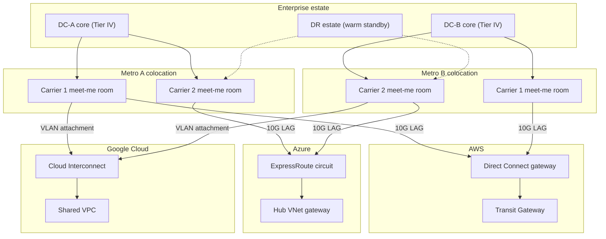

## 2. Addressing and route-summarisation plan

Each cloud receives a single summary block from the enterprise supernet. Individual subnets stay internal, which keeps routing tables small and limits exposure to a route leak.

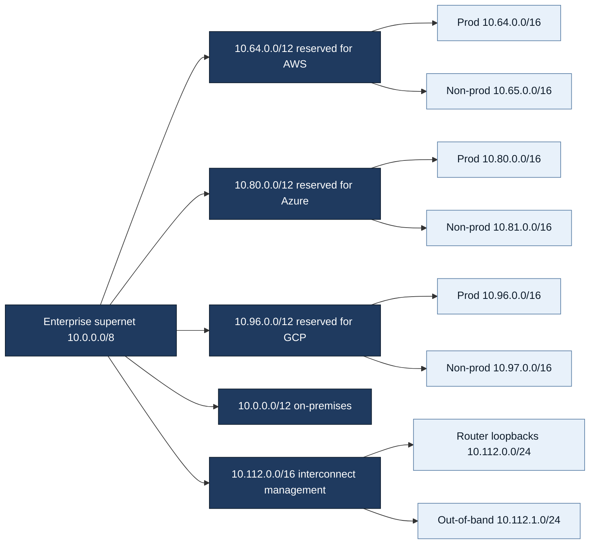

## 3. BGP policy exchange across the fabric

The enterprise advertises summaries and rejects default routes from any cloud. Each cloud's session carries a maximum-prefix guard, so an accidental flood of routes shuts the session rather than polluting the core.

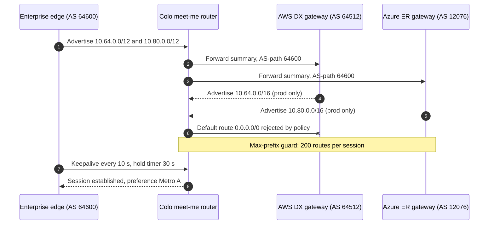

## 4. Metro-A failure: failover sequence

What happens when a whole colocation facility is lost, from detection through automatic reroute to restoration.

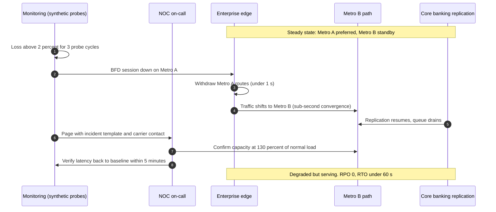

## 5. Blast-radius map by failure domain

Each row is a failure a board member would ask about, and the design control that contains it.

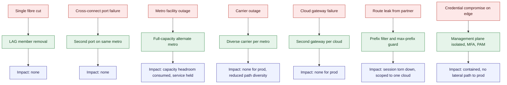

## 6. Interconnect operating-state machine

The operating state of each cloud path, with the transitions that move it between normal service, degraded service and declared incident.

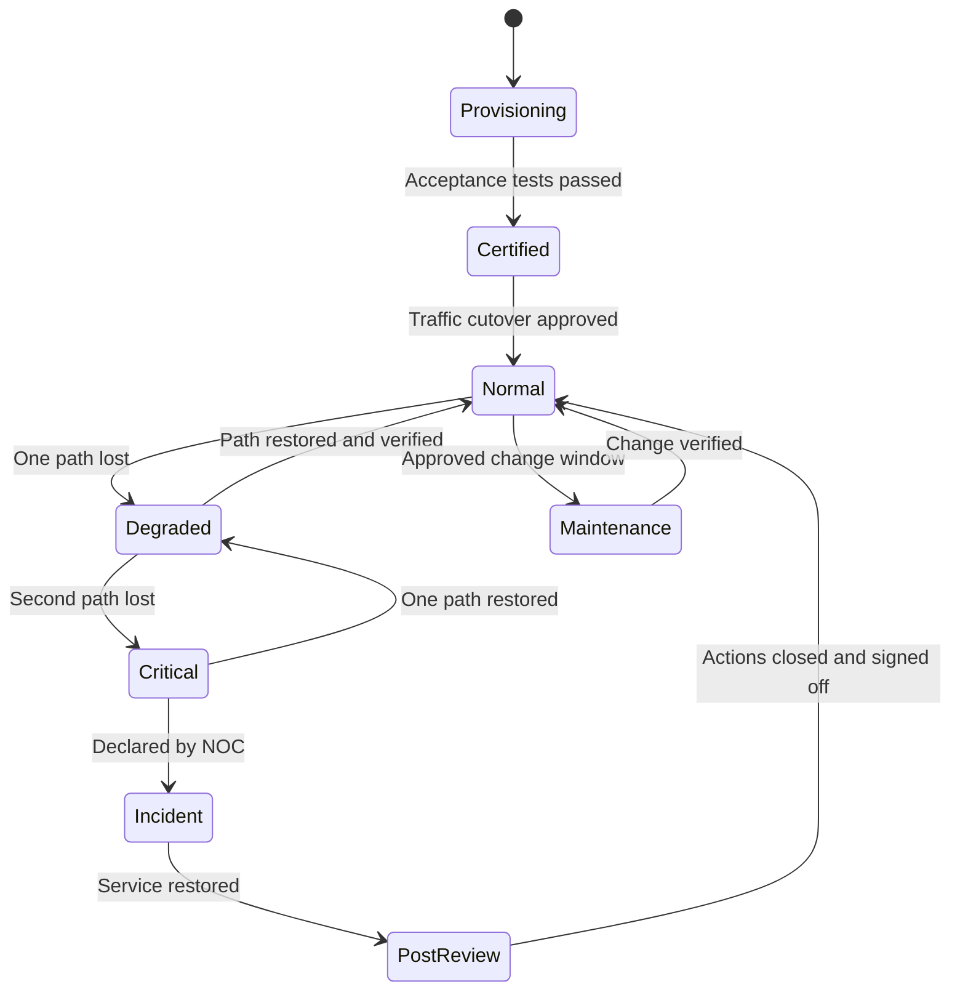

## 7. Traffic classes and QoS marking

Traffic is classified at the edge and given a guaranteed share of the links. Replication and control traffic are protected even under saturation.

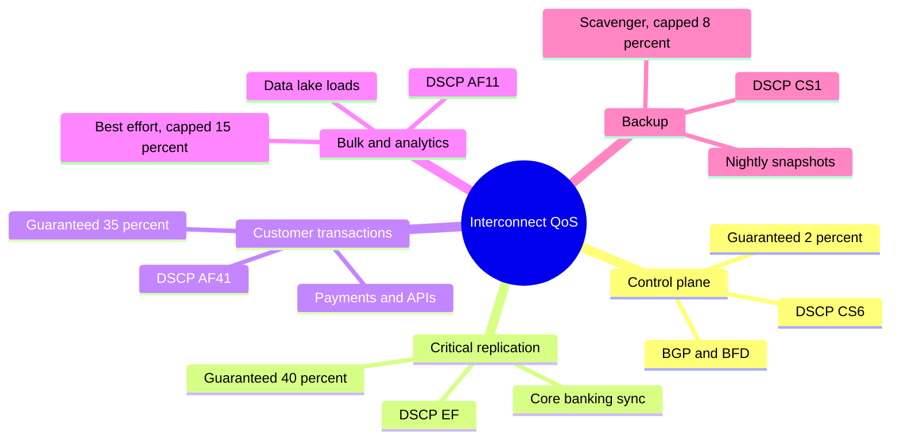

## 8. Layered encryption and inspection path

Every frame crosses three protection layers before it reaches a cloud boundary. Inspection happens on the enterprise side, where the security team controls the keys.

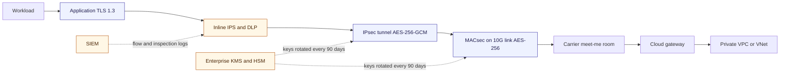

## 9. Eighteen-month phased rollout

Phase 1 delivers the first metro and two clouds. Carrier lead times drive the critical path, so routing and monitoring work starts while circuits are being procured.

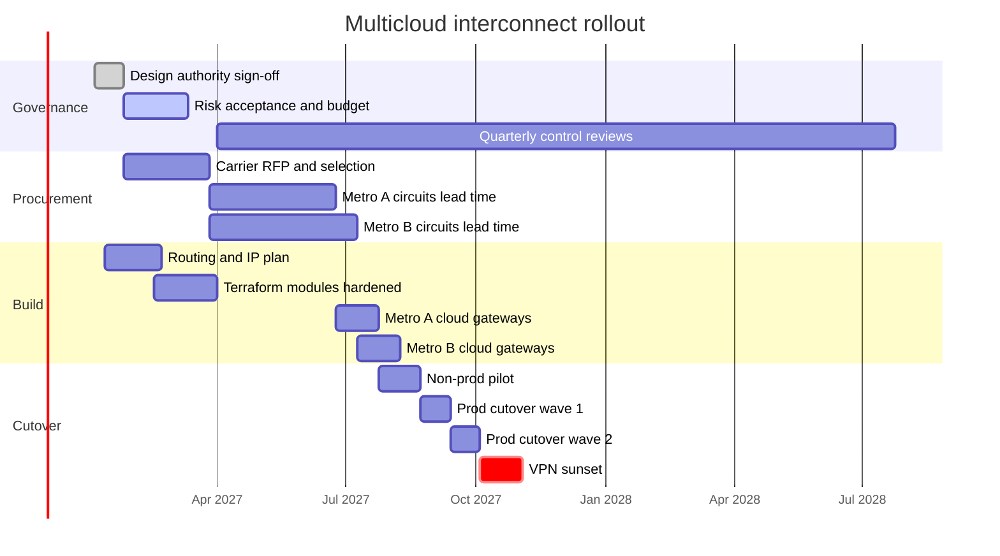

## 10. Change-approval governance gates

No change reaches production without passing each gate. Gates are enforced in the pull-request pipeline and recorded for audit.

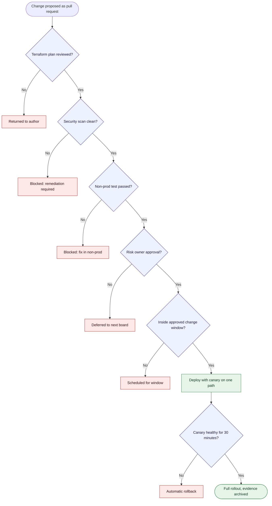

## 11. Annual run-cost composition

Illustrative split for a dual-metro, three-cloud design. Replace with contract figures before any funding decision.

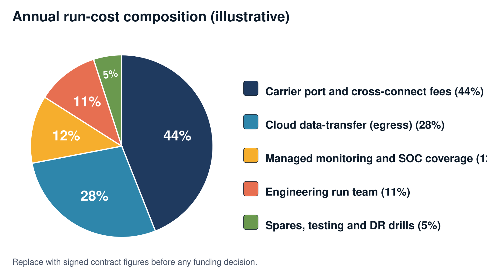

## 12. Option positioning: cost against resilience

Where each connectivity option sits on the cost and resilience scale. The target quadrant is high resilience at a cost the business can defend.

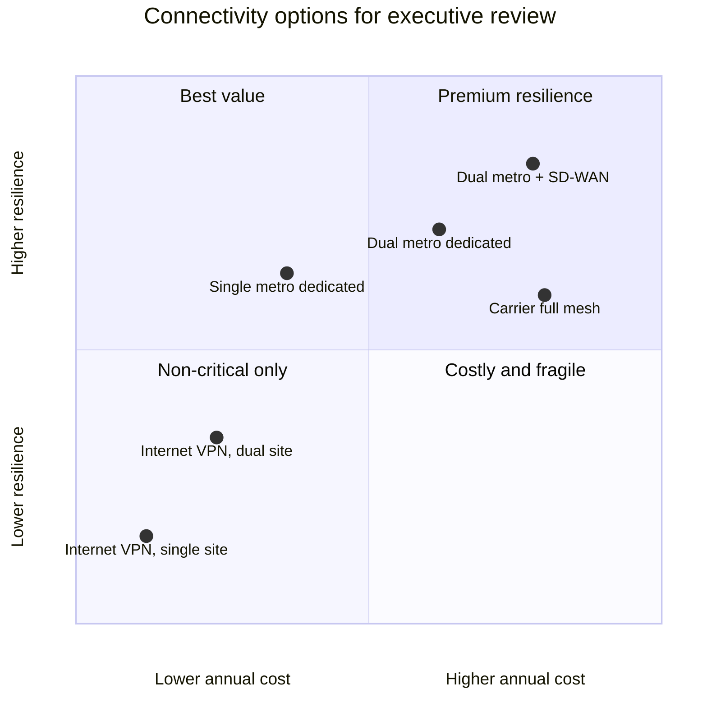

## 13. Pattern selection decision tree

A practical route from business requirement to interconnect pattern. Each leaf links to an ADR in `docs/decisions.md`.

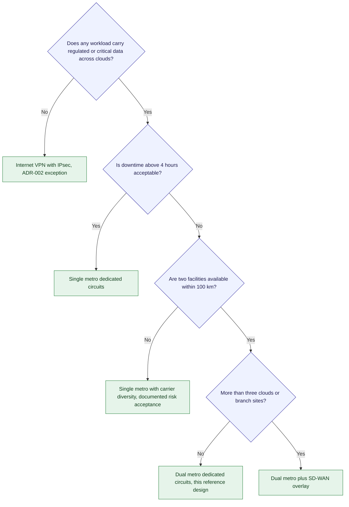

## 14. Telemetry and observability pipeline

Every path emits flow, routing and performance telemetry into one pipeline. Dashboards for the CIO and the regulator are generated from the same data the NOC uses, so the numbers agree.

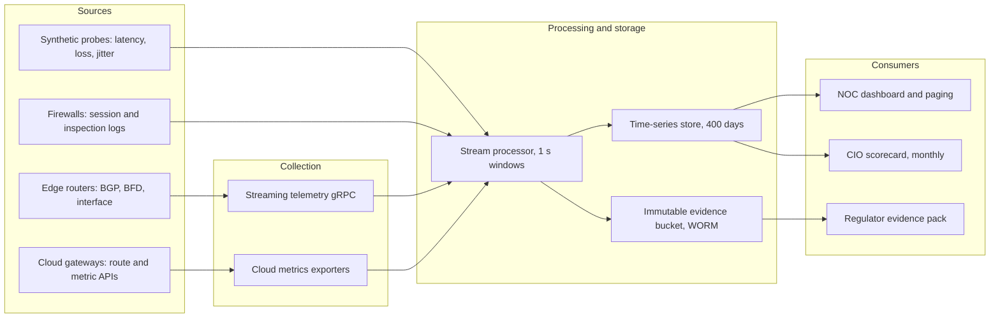

## 15. Cutover experience for application owners

What an application owner lives through during a cutover, scored from calm (5) to stressful (1). The aim is that no owner ever scores below 3.

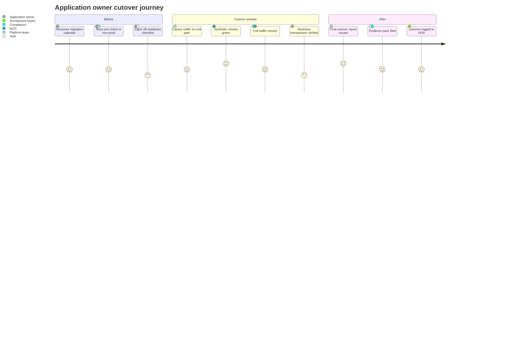

