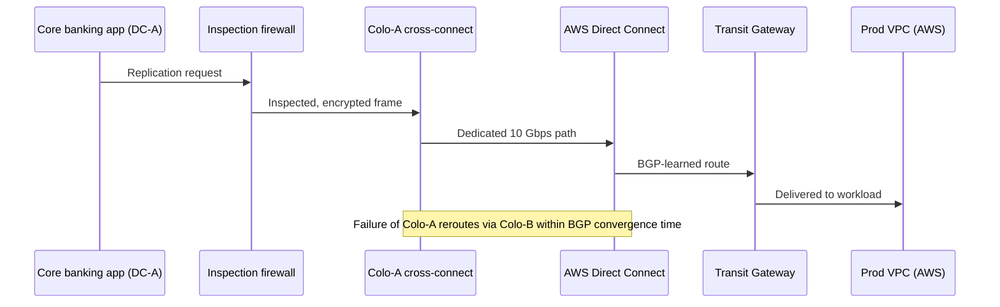
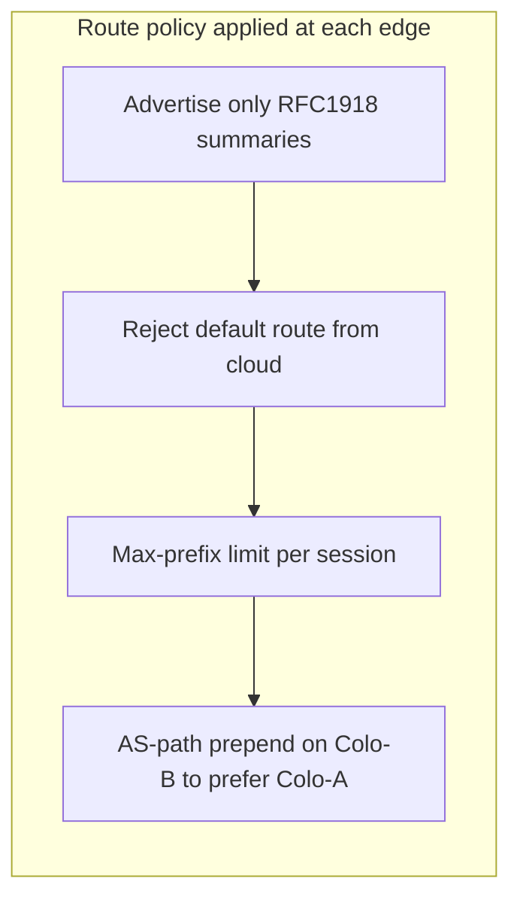
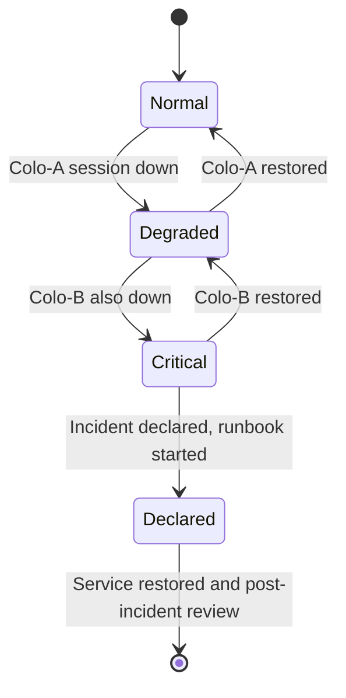

# Architecture

## Design principles

1. **Two facilities, two carriers, no shared fate.** No single facility, carrier or cloud control plane may take down all cross-cloud paths.
2. **Private by default.** Dedicated circuits carry production traffic. Internet VPN is a documented backup only.
3. **Least route exposure.** Each cloud sees only the prefixes it needs. Default routes are never advertised across the interconnect.
4. **Everything as code.** Circuits, routing policy and gateways are declared in Terraform and reviewed like application code.
5. **Measured, not assumed.** Latency, loss and failover time are monitored and reported monthly to the CIO.

## Traffic flows

## Routing policy

## Failover sequence

## Capacity model

Each facility is sized to carry 100 percent of peak cross-cloud traffic on its own, with headroom of 30 percent. Use `tools/Get-InterconnectModel.ps1` to recalculate when traffic forecasts change.

## Known limits

- Cross-cloud latency is bounded by physical distance; target figures must be validated per metro pair.
- Provider SLAs differ. The design uses the lower of the two commitments as the planning baseline.
- Carrier diversity depends on physical route audits, which must be repeated annually.
